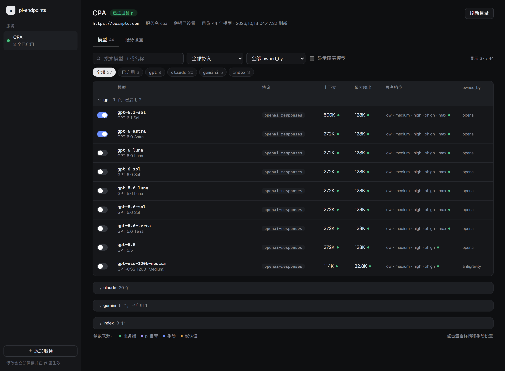
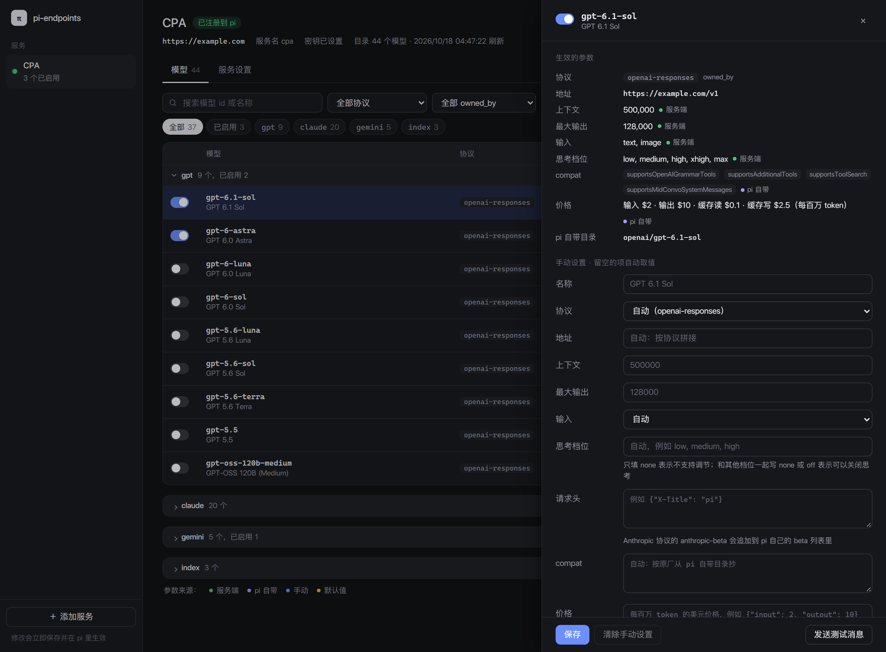

# pi-endpoints

让 [pi](https://pi.dev) 通过你自己的 API 服务使用模型，例如自己部署的 [CLIProxyAPI](https://github.com/router-for-me/CLIProxyAPI)、Magpie，或者基于 new-api / one-api 的中转站。





- **只注册你选定的模型。** 服务上有几十个模型时，pi 的模型列表里只出现你启用的那几个。
- **参数取自服务本身。** 上下文长度、最大输出、思考档位优先用服务端目录返回的值。pi 不会提供服务不支持的档位，例如在只支持 low 到 max 的 GPT 上，不会出现"关闭思考"。
- **自动选择协议。** 每个模型按服务端信息和模型名，选用 OpenAI Responses、OpenAI Chat Completions、Anthropic Messages 或 Google Generative AI 协议，也可以手动指定。
- **可以同时接入多个服务。** 每个服务在 pi 里是一个服务商，模型写成 `<服务名>/<模型 id>`，例如 `cpa/gpt-6.1-sol`。
- **密钥和配置分开存放。** 密钥单独存放在本机，配置文件可以同步到别的电脑。

## 安装

需要 pi 1.3.0 或更高版本。

```bash
pi install npm:pi-endpoints
```

## 快速上手

1. 在 pi 里运行 `/endpoints`，浏览器会打开管理页。
2. 点"添加服务"，填写显示名（如 `CPA`）、服务地址（如 `https://example.com`，不带 `/v1`）和 API 密钥。名字按显示名自动生成（如 `cpa`），也可以自己改。
3. 点"添加"。插件保存服务后立即读取服务上的模型列表，读取失败时页面顶部显示服务端返回的原因，服务照样保存。
4. 在"模型"页打开要用的模型的开关。打开后立即生效，在 `/model` 里就能选到，或者用 `pi --model cpa/gpt-6.1-sol` 指定。

## 管理页

插件只有一个命令 `/endpoints`，所有操作都在它打开的管理页里完成。

管理页只在本机 `127.0.0.1` 上开放，每次运行 `/endpoints` 都会生成新的随机链接。退出 pi，或者运行 `/reload`、`/new`、`/resume` 这类切换会话的命令后，页面失效，需要重新运行 `/endpoints`。

左栏底部显示插件的版本号。npm 上有新版本时，版本号右边出现绿色的向上箭头，点击打开这个版本的 Release 页面；用 `pi update --extensions` 更新。

左栏列出所有服务，服务名旁的圆点表示是否已注册到 pi，红色表示有错误。右边的开关停用整个服务：停用后不注册到 pi，已启用的模型、手动设置和密钥都保留，重新打开后恢复，并刷新一次目录。停用的服务排在启用的服务下面，中间用横线隔开；刚停用或刚启用的服务先留在原处，方便改回来，刷新页面后再挪到对应的一组。打开页面时默认选中第一个启用的服务。服务有已启用模型的新版、可以[自动换用](#自动换用新版本)时，服务名旁显示"有新版"。选中一个服务后，页头显示地址、密钥状态和目录的刷新时间，"刷新目录"按钮立即读取服务上的模型列表，也可以用来测试连接。下面分"模型"和"服务设置"两页。

- **模型**：用开关启用或停用模型。列表按模型 id 的前缀分组，分组可以折叠。`gpt`、`claude`、`gemini`、`grok` 按这个顺序排在前面，其余前缀按字母序排在后面。每组按模型名里的版本号从新到旧排列，如 `gpt-6.1-sol`、`gpt-6-sol`、`gpt-5.6-sol`；名字里没有版本号的排在最后。列表上方的按钮可以只看已启用的模型或某个前缀的模型；"已启用"旁边是"每个系列只保留最新版"开关，旁边写着"已开启"或"未开启"，见[自动换用新版本](#自动换用新版本)。在"已启用"里停用的模型先留在原处，方便改回来，再点一次"已启用"、改了筛选条件、切换服务或刷新页面后移走；[自动换用新版本](#自动换用新版本)启用的新版本会补进这一页，被换掉的旧版本如果还在服务目录里，同样先留着；已经不在目录里的旧版本停用后不再显示。还可以按模型 id 或名称搜索，按协议和 `owned_by` 筛选；服务端标为隐藏（`visibility: hide`）的模型，以及名字里带 `image` 一词的图片生成模型，默认不显示，勾选"显示隐藏模型"后显示，也可以启用。没有勾选"显示隐藏模型"时停用的隐藏模型，以及按协议筛选时在详情里改了协议的模型，也先留在原处，改了筛选条件、切换服务或刷新页面后再按规则显示。选中的前缀按钮在数量变为 0 时仍然保留，点"全部"取消。上下文、最大输出和思考档位后面的圆点表示值的来源："服务端"、"pi 自带"（pi 内置的模型目录）、"models.dev"、"手动"或"默认值"，取值顺序见[参数来源](#参数来源)。列表下方的图例旁显示 models.dev 数据的更新时间，拉取失败时显示原因。在管理页刷新目录时，页面等 models.dev 拉取完成才更新，所以一般看不到拉取过程；只有页面拿到状态时正在拉取（例如打开页面时 pi 正在后台拉取），才显示"正在拉取"。用了默认值的模型标为"缺参数"，请手动补齐；已启用但服务上已经没有的模型标为"目录里没有"。
- **对话以外的模型**：models.dev 把一些模型标为分类、图片生成、向量等对话以外的类型，pi 不能拿这类模型对话，插件不把它们注册到 pi。这类模型按隐藏模型处理，默认不显示；列表里带"分类模型"、"图片模型"、"向量模型"这样的标签，其他类型直接显示类型名。它们的开关不能打开，已经启用的可以停用，也不能设为 pi 默认模型。模型详情的顶部说明了原因。
- **pi 默认模型**：pi 新开会话时使用的模型在模型名后面标一颗实心星；这个模型没有注册到 pi 时，星标变灰。鼠标移到其他模型上会出现空心星，点一下设为默认，只有已启用的模型可以设；再点实心星取消默认（页面打开后默认模型已经被换掉时不取消，只更新页面），pi 新开会话时改用 Ctrl+P 列表的第一个或 pi 自带的默认模型；模型详情里也有同样的星标。这和在 pi 的 `/model` 里按 Ctrl+S 是同一个设置，写在全局的 `settings.json` 里：新开的 pi 立即生效，运行中的 pi 需执行 `/reload`。项目目录的 `.pi/settings.json` 里设了 `defaultModel` 时，在那个目录里以项目设置为准。
- **模型详情**：点一个模型，右侧打开详情，列出生效的参数和各自的来源，以及匹配到的 pi 自带目录和 models.dev 条目，下面是手动设置。可以覆盖名称、协议、地址、上下文、最大输出、输入类型、思考档位、请求头、compat 和价格，留空的项自动取值。
  - 上下文和最大输出可以写成 `1000000`、`1,000,000`、`1 000 000`、`200K`、`1M` 或 `1.5M`，K 表示 1000，M 表示 1000000，不分大小写。结果必须是正整数，认不出时报错，不保存。
  - 思考档位填 pi 的档位名，如 `low, medium, high`；只填 `none` 表示不支持调节思考；和其他档位一起写 `none` 或 `off`，表示可以关闭思考。
  - compat 只写要改的字段，其余字段照常从 pi 自带目录取；字段的值写 `null` 表示删掉这个字段。生效的参数里，每个 compat 标签的悬停提示显示该字段的来源，手动删掉的字段显示为带删除线的标签。
  - 保存失败的原因和测试结果显示在底部按钮的上方。
  - 手动设置有未保存的修改时，按 Esc、点面板外面或点 × 关闭面板前会先确认。焦点在输入框、文本框或下拉框里，或者输入法正在选字时，Esc 不关闭面板。
- **发送测试消息**：在模型详情里，用当前生效的参数给模型发一条消息。按钮旁的下拉框可以选思考档位，默认"不设置"，结果里写明发出的档位；模型不支持调节思考时没有这个下拉框。失败时显示服务端返回的原文，中转站的错误信息常常直接说明了原因，例如提示不支持所选模型，多半是协议选错了。
- **服务设置**：密钥，以及显示名、名字、地址、密钥环境变量、默认协议和加在这个服务所有请求上的请求头。名字里的大写字母在输入框失焦时转为小写；改显示名不会改名字，因为改名字会让 pi 里引用 `<服务名>/<模型 id>` 的设置失效。协议按模型分别判断，同一服务可混用多种协议，无需按协议拆分；默认协议仅在无法判断时使用。请求头的值按原样发送，不解释 `$环境变量` 这类写法。密钥只能写入，页面只显示"已设置"或"未设置"，以及密钥来自文件还是环境变量。保存密钥失败时，已填的密钥留在输入框里。

## 自动换用新版本

服务端换了模型版本时（如 `gpt-6.1-sol` 换成 `gpt-6.2-sol`），已启用的旧模型会变成"目录里没有"。在服务的"模型"页打开"每个系列只保留最新版"后，插件会自动换成新版本。这个开关按服务分别设置；在管理页添加服务时默认打开，可以在添加表单里取消；配置里没写这个开关时为关闭。

开关关着、目录里有已启用模型的新版时，左栏服务名旁显示"有新版"，"模型"页顶部列出这些新版（如"gpt-6.1-sol → gpt-6.2-sol"）：点"换成新版"按下面的规则只换这一次，不打开开关，pi 的默认模型和 Ctrl+P 列表一起换；点"开启自动替换"打开开关。pi 里也会提醒，见下文的"新版提醒"。

- **系列**：插件按模型 id 认出系列。名字按 `-` 拆开，4 位及以上的纯数字段（如 `20250929`、`0324`）是日期，`2024-08-06` 这样拆开写的日期按 `20240806` 处理；剩下的段里，连续的版本段是版本，其余部分是系列名，`codex/` 这类前缀也算在系列名里。版本段是不超过 3 位的数字，或者带 `.` 的数字，可以以 `v` 开头，如 `6`、`6.2`、`v2.6`；`5-5` 读作 5.5。例如 `codex/gpt-6.2-sol` 属于 `codex/gpt-sol` 系列，版本 6.2；`claude/claude-opus-5-5` 属于 `claude/claude-opus` 系列，版本 5.5；`deepseek-v3-0324` 属于 `deepseek` 系列，版本 3，日期 0324。版本相同时日期新的算新版，只有一边带日期时算同一版本。名字里没有版本号的模型（如 `Index-Translate-35B-A3B`）不属于任何系列，不受影响。系列名区分大小写。
- **换哪些模型**：只处理已经启用了至少一个模型的系列。插件启用目录里这个系列最新的模型，停用这个系列里其他已启用的旧版本，包括目录里已经没有的。目录里的隐藏模型和对话以外的模型不会被选为新版。旧版本的手动设置保留在配置里，不会复制给新版本。
  - 最新版本有多个 id 时（如别名 `claude-sonnet-4-5` 和 `claude-sonnet-4-5-20250929`），要启用新 id 时选带日期的、日期最新的那个；都不带日期时选不带日期的。
  - 同一版本的多个 id 都在目录里时，可以同时保留。已启用的 id 从目录里消失、目录里还有同版本的其他 id 时，按上一条选一个接替。
  - 已启用的模型比目录里的最新版还新，或者和最新版同版本但在目录里被隐藏时，不降级，这个系列不动。
- **对话以外的模型**：要靠 models.dev 判断候选是不是对话模型。打开开关的服务，以及没打开开关、但目录里有已启用模型的候选新版的服务，会让插件下载 models.dev；本机从没拿到过 models.dev 数据时先不换，等下载成功后的下次刷新。有数据、但 models.dev 里查不到的模型按对话模型处理。
- **什么时候换、什么时候生效**：
  - 打开开关、在管理页点"刷新目录"或添加服务时，立即换，并重新注册到运行中的 pi。models.dev 到了该更新的时候，先等它下载完（最多 60 秒）。
  - pi 自己刷新目录时（启动后、打开 `/model` 时，见[目录何时刷新](#目录何时刷新)），只把新的启用列表写进 `endpoints.json`，并改好 pi 的默认模型和 Ctrl+P 列表；运行中的 pi 的模型列表不变，pi 会提示一句"<服务名>：旧版本 → 新版本 已写入配置，新会话生效，当前 pi 用 /reload"。之后新开的 pi 和新启动的子代理直接用新版本；运行中的 pi 下次启动或执行 `/reload` 后用上新的模型列表和默认模型。
  - 刷新失败时不换。
- **pi 的设置**：pi 的默认模型是被停用的旧版本时，改成新版本。Ctrl+P 列表（`enabledModels`）里写着旧版本完整名字（如 `cpa/gpt-6.1-sol`）的项换成新版本，新版本已在列表里时只删掉旧的；通配符不改。`settings.json` 读不了时跳过这一步。
- **运行中的会话**：正在用旧版本的会话不会自动切换。在管理页换了模型时，pi 会提示"<服务名>：旧版本 → 新版本。当前会话请用 /model 切换"。
- **新版提醒**：服务没打开开关时，pi 自己刷新目录后，如果已启用的模型出了新版（按上面的规则判断），pi 会提示，例如“Magpie 有新版模型：claude-opus-5-5 → claude-opus-5-6。输入 /endpoints，在模型页点“换成新版”只换这一次，或点“开启自动替换”以后自动换。”这时运行 `/endpoints`，管理页直接打开有新版的服务的"模型"页，顶部列出这些新版；几个服务都有新版时，打开 `endpoints.json` 里排在最前面的那个，其他服务在左栏标着"有新版"。同一个新版最多每 7 天提醒一次，直到换掉或停用旧版、打开开关为止；同时运行多个 pi 时可能各提醒一次。没有界面的运行（如 `pi -p`、子代理、pi-web-ui 的子代理和后台会话）不显示提示，也不算提醒过；在 pi-web-ui 里，提醒显示在同一个客户端的主界面上；插件靠 pi 的内部字段 `ModelRegistry.runtime` 区分客户端，能读到这个字段时提醒不会发给别的客户端，读不到时可能发给别的客户端，见[已知限制](docs/architecture.md#已知限制)。用 `pi --mode rpc` 接入的客户端如果没有显示这条提示，它也会算作提醒过，7 天后再提醒。只有设置了密钥的服务才会提醒。本机还没有 models.dev 数据时先不提示，等下载成功后的下次刷新。已经提示过的新版记在 `endpoints-state.json` 里。

打开开关后，手动启用的旧版本也会在下次刷新时被换掉。需要同时使用同一系列的不同版本时，关掉这个开关。

已知限制：

- models.dev 数据过期、下载又一直失败时，新出现的模型可能还没有分类，会被当作对话模型选为新版。
- 同时运行多个 pi 时，它们对配置和 pi 设置的修改之间没有跨进程的锁，同时修改时后写的可能覆盖先写的。
- 管理页刷新目录、等 models.dev 的那段时间里，在 pi 里打开 `/model` 可能短暂看到不一致的模型列表，刷新结束后恢复。
- 改了服务的地址和密钥后（通常是在另一个 pi 里改的），正在用已停用或已被换掉的模型的会话，下一条请求可能把新密钥发到旧地址。这是插件原有的行为，不是这个功能引入的。改了地址或密钥后，请在各个 pi 里运行 `/reload`，或用 `/model` 重新选模型。

## 参数来源

每项参数按下面的顺序取值，越靠前越优先：

1. 你在管理页里手动填写的值。
2. 服务端目录返回的值。CLIProxyAPI 和 Magpie 会返回上下文、最大输出和思考档位，new-api 类中转站一般只返回模型名。
3. pi 自带的模型目录里同名模型的值。匹配时会去掉 `codex/` 这类前缀，以及日期和 `-high` 这类后缀。这些是官方 API 的参数，可能和走订阅账号的服务不一致。
4. [models.dev](https://models.dev) 目录里同名模型的值，用来补齐 pi 自带目录里没有的模型。只查 OpenAI、Anthropic、Google、DeepSeek 这类模型原厂，不查转卖别家模型的服务商。名单和字段的对应关系见[技术文档](https://github.com/PosvdM/pi-endpoints/blob/main/docs/architecture.md#modelsdev)。
5. 保守的默认值：上下文 128000，最大输出 16384，不支持调节思考。

另外两项的取法不同：

- **compat**（协议兼容设置）：按模型原厂从 pi 自带目录里同名模型抄过来，不从服务端和 models.dev 读取。背后是 ChatGPT 订阅的服务上的 GPT 模型，抄订阅版 `openai-codex` 的设置。手动填写的 compat 逐字段覆盖抄来的设置，没写的字段保留；字段的值写 `null` 表示删掉抄来的这个字段，例如 `{ "supportsStrictTools": null }`。Anthropic Messages 的[会话亲和默认值](#会话亲和请求头)也按这个规则合并。
- **价格**：先按原厂从 pi 自带目录里抄官方 API 的价格，找不到时用 models.dev 里的价格，都没有时为 0。pi 显示的花费是"相当于官方 API 的花费"。

## 会话亲和请求头

Anthropic Messages 协议的模型默认开启 `sendSessionAffinityHeaders`，即使没有抄到 compat 或手动设置中未填写这个字段，也会开启。其他协议不添加这个默认值。

有 pi 会话 ID 时，pi 发送 `x-session-affinity: <会话 ID>`，供 CLIProxyAPI 等服务固定同一会话使用的账号；使用 OpenRouter 格式时请求头为 `x-session-id`。如需关闭，在模型的手动 compat 中设置 `"sendSessionAffinityHeaders": false`。

## Anthropic 的 beta 请求头

走 Anthropic 协议的 Claude 模型，上下文超过 200000 时，插件自动在请求里加上 `anthropic-beta: context-1m-2025-08-07`。CLIProxyAPI 这类背后是 Claude 订阅账号的服务，只有请求带上它才提供 1M 上下文。不需要时，在模型的手动设置里把上下文改成 200000，就不会再加。

在服务或模型的请求头里写的 `anthropic-beta`，会追加到 pi 自己按模型能力生成的 beta 列表里，多个值用逗号分开。

## 配置文件

所有文件都在 pi 的配置目录下（默认 `~/.pi/agent/`）：

| 文件 | 内容 | 可以同步 |
|---|---|---|
| `endpoints.json` | 服务列表、启用的模型、请求头和手动设置 | 可以。请求头也保存在这里，不要把密钥写进请求头 |
| `endpoints-auth.json` | 每个服务的密钥。在 macOS 和 Linux 上权限为 600 | 不要同步 |
| `endpoints-cache.json` | 各服务模型目录的缓存 | 不需要 |
| `endpoints-modelsdev.json` | 从 models.dev 下载的模型参数，只含名单上的原厂 | 不需要 |
| `endpoints-state.json` | 已经提醒过的新版和提醒的时间。删掉后同一个新版会再提醒一次 | 不需要 |

在服务设置里填写"密钥环境变量"（如 `CPA_API_KEY`，只写名字，不带 `$`）后，只要这个环境变量有值，就优先用它作为密钥。适合 CI 这类没有管理页的环境：同步 `endpoints.json`，再设置环境变量即可。

可以同时运行多个 pi：每次修改前都会重新读取这几个文件，在最新内容上修改，所以不会用一份旧内容整份覆盖别的 pi 先前做的修改。两个 pi 恰好同时读、改、写同一个文件时没有加锁，后写的仍可能覆盖先写的。别的 pi 要运行 `/reload` 才会用上新配置。手工编辑 `endpoints.json` 后也要运行 `/reload`。文件写坏时插件照常加载，管理页会显示错误，修好之前不能修改配置。

## 目录何时刷新

- 启动时用目录缓存和 models.dev 的本地文件注册模型，不等待网络，服务连不上也能照常启动。
- 交互模式和 RPC 模式启动后，以及打开 `/model` 时，pi 会刷新已注册服务的目录。
- 打开管理页时，在后台刷新所有已启用、已设置密钥的服务；在管理页重新启用一个服务时，刷新这个服务。
- 在管理页点"刷新目录"，会立即刷新这个服务。
- 用 `pi -p` 这类非交互方式运行时不刷新，直接用缓存。

每次刷新最多等 15 秒。刷新失败时保留上次的缓存，失败原因显示在管理页里。服务打开了"每个系列只保留最新版"时，刷新成功后接着[换用新版本](#自动换用新版本)。

models.dev 的数据保存在 `endpoints-modelsdev.json`。只有在未停用、已设置密钥的服务里，有模型的上下文、最大输出、输入类型、思考档位或价格要靠 models.dev 或默认值补齐，或者要靠 models.dev 判断模型类型（服务打开了“每个系列只保留最新版”，或者目录里有已启用模型的候选新版，见[自动换用新版本](#自动换用新版本)）时，才会下载：

- 本地没有数据，或上次检查已超过 24 小时，才会下载。数据没有变化时 models.dev 不重新发送整份目录。
- pi 刷新目录后在后台下载，不拖慢启动；拿到新数据后重新注册模型。
- 在管理页刷新目录或添加服务时，接着检查 models.dev，最多等 60 秒。models.dev 下载失败不影响目录刷新，30 分钟后再试。
- 用 `pi -p` 这类非交互方式运行时不下载，只用本地文件。

## 限制

- 服务名不能和 pi 自带的服务商同名（如 `openai`、`anthropic`），否则会替换掉 pi 自带的模型。
- 不支持 Codex 原生协议（`/backend-api/`、Fast 模式、WebSocket）。GPT 模型走服务的 `/v1/responses`。
- 只有未停用、有已启用模型、并且设置了密钥的服务才会注册到 pi。
- models.dev 标为分类、图片生成、向量等非对话类型的模型不能启用；之前已启用的保留在配置里，但不注册到 pi。插件不把它们注册成 pi 的分类模型或图片模型。

## 开发

需要 Node.js 22.19 或更高版本（和 pi 相同）。

```bash
npm install
npm run check   # 类型检查
npm test        # 单元测试
pi -e .         # 在 pi 里加载当前目录试用
```

架构、数据格式和设计约束见 [技术文档](https://github.com/PosvdM/pi-endpoints/blob/main/docs/architecture.md)。

## 许可证

[GNU AGPL-3.0-or-later](https://github.com/PosvdM/pi-endpoints/blob/main/LICENSE)
